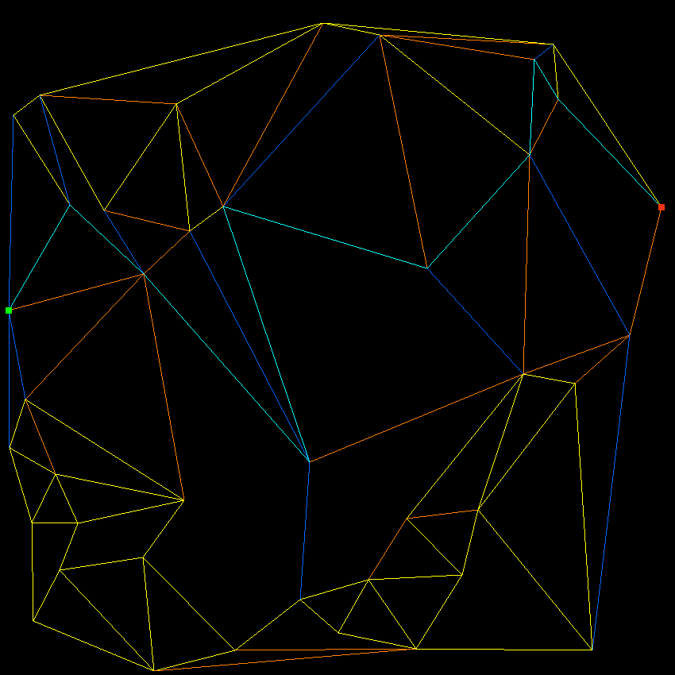

# graph-search-visualizer

[](https://github.com/Wil12Fred/ai-algorithms/actions/workflows/graph-search-visualizer.yml) [](../LICENSE)

A graph-search visualiser in C++ and OpenGL/GLUT: breadth-first search and
greedy best-first search on a random Delaunay map with obstacle edges.



## Features

- Scatters `n` nodes at random in an 850x850 area and connects them with a
  Delaunay triangulation (O(n^4), so keep `n` in the tens), capping node
  degree; about 1 in 10 edges becomes an **obstacle** (orange) no search may
  cross.
- Searches from node `0` (green) to the last node (red) with
  **option 1**: breadth-first search, or **option 2**: greedy best-first
  search using straight-line distance to the goal.
- Draws explored edges in blue and the path found in cyan; prints `Llego`
  (reached) or `No Llego` and the path node ids, goal to start.
- Keys: arrows pan, `+`/`-` zoom, `F1`/`F2` switch search, `Esc` quits.

## Requirements

A C++11 compiler, `make` and OpenGL/GLUT. For the headless smoke test also
Xvfb and (optionally) xdotool.

- Debian/Ubuntu: `sudo apt install g++ make freeglut3-dev xvfb xdotool`
- Arch: `sudo pacman -S gcc make freeglut xorg-server-xvfb xdotool`
- macOS: the system OpenGL/GLUT frameworks.

## Build

```bash
make
```

## Run

```bash
./main          # then type the number of nodes and the option, e.g. 40 and 2
printf '40\n2\n' | ./main
```

Console output of a real run (`40`, option `2`; the window shows the map):

```
Numero de Nodos: Opcion 1: Busqueda en Amplitud
Opcion 2: Heuristica Mejor el Primero
Llego
16
31
30
25
24
...
```

## Tests

```bash
make test       # unit tests, no window
make smoke      # headless run on a private Xvfb display
```

- `tests/test_busqueda.cc`: BFS returns a shortest path (4 edges corner to
  corner on a 3x3 grid); obstacle edges are never crossed and a node walled
  off by obstacles is unreachable for both searches; best-first reaches the
  goal with a valid path and explores fewer edges than BFS on a 6x6 grid.
- `tests/test_teclado.cc`: `+`/`-` zoom through the ASCII keyboard
  handler, arrows still pan through the special-key handler, `Esc` exits
  with status 0, and `busqueda.cc` registers the keyboard handler.
- `tests/smoke.sh` (always under `xvfb-run`, never the real desktop): the
  program keeps running until `timeout` (exit 124), the menu says BFS
  ("Amplitud"), a search result is printed, and — with xdotool — pressing
  `Esc` in the window ends it with exit 0.

## Project layout

| File | Contents |
|---|---|
| `busqueda.cc` | entry point, input and render loop |
| `grafo.h`, `nodo.h` | undirected graph with obstacle edges; BFS and best-first search |
| `delaunay.h` | Delaunay triangulation used to build the map |
| `grafoAlgoritmos.h` | random point generation and graph construction |
| `grafoInterfaz.h` | OpenGL drawing of the graph and the search |
| `camara.h`, `windowControl.h` | 2D camera, keyboard and reshape handlers |
| `geometria.h`, `xorshift.h` | 2D point type and random generator |
| `tests/` | unit tests and the headless smoke run |

## Known limitations

- Fixed: the menu called option 1 "Busqueda en Profundidad" (depth-first)
  although the code is BFS; it now says "Busqueda en Amplitud". The drawing
  function keeps its original name, `graficarCaminoDeGrafoProfundidad`.
- Fixed: `Esc`, `+` and `-` were registered on GLUT's special-key
  callback, which never delivers ASCII keys, so they did nothing.
- The search runs again, and prints again, on every redraw.
- Uses the legacy fixed-function OpenGL/GLUT API (deprecation warnings are
  silenced on macOS). Identifiers and prompts are in Spanish.

## Background

First assignment ("Búsqueda") of a university Artificial Intelligence
course, 2017.

## License

MIT — see [LICENSE](../LICENSE).
