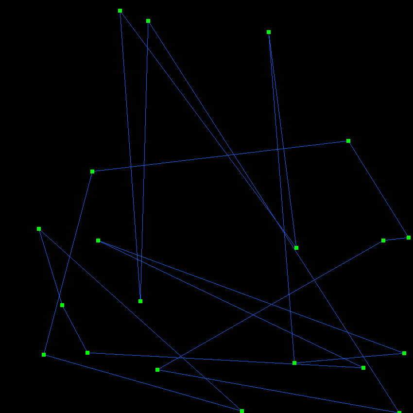

# AgenteViajero

**Unfinished** travelling-salesman ("agente viajero") solver in C++ with an
OpenGL/GLUT view. University Artificial Intelligence coursework, September
2018. Identifiers, prompts and comments are in Spanish.



## Status: the fitness function was never written

The scaffolding is complete: random cities, a permutation chromosome, order
crossover, swap mutation, a genetic-algorithm loop and the drawing of the
resulting closed tour. What is missing is `Problema::aptitud` in
`genetico.h`, which is still a TODO ("actualizar funcion distancia de acuerdo
al grafo y el individuo"). It returns `0` for every tour, so nothing guides the
search and **the tour shown is effectively a random permutation, not an
optimised route**.

Writing that function (sum of edge lengths along the tour, turned into a
"higher is better" score) is what would make this a working TSP solver.

## Build and run

Needs a C++11 compiler, `make` and OpenGL/GLUT
(Debian/Ubuntu: `sudo apt install freeglut3-dev`; Arch: `freeglut`; macOS: the
system frameworks).

```bash
make
./main          # then type the number of cities, e.g. 20
# or
echo 20 | ./main
```

A window titled "Busqueda" shows the cities (green) and the tour (blue). Arrow
keys pan; close the window to exit.

## Sample output

```
Numero de Nodos: 20
20
```

(The prompt, then the number of cities created, printed once by `main` and
once by the first redraw.)

## Layout

| File | Contents |
|---|---|
| `main.cc` | entry point, input and render loop |
| `genetico.h` | individual (order crossover, swap mutation), `Problema` and the GA |
| `represent.h` | permutation chromosome |
| `grafoAlgoritmos.h` | random cities and the GA call that builds the tour |
| `grafoInterfaz.h` | OpenGL drawing of the tour |
| `grafo.h`, `nodo.h`, `geometria.h` | graph and 2D point types |
| `camara.h`, `windowControl.h`, `xorshift.h` | camera, input handlers, random generator |

The graph and drawing code come from `BusquedaInteligenciaArtificial`; the GA
is an earlier, non-generic version of the one in `AlgoritmoGenetico`.
